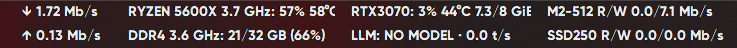
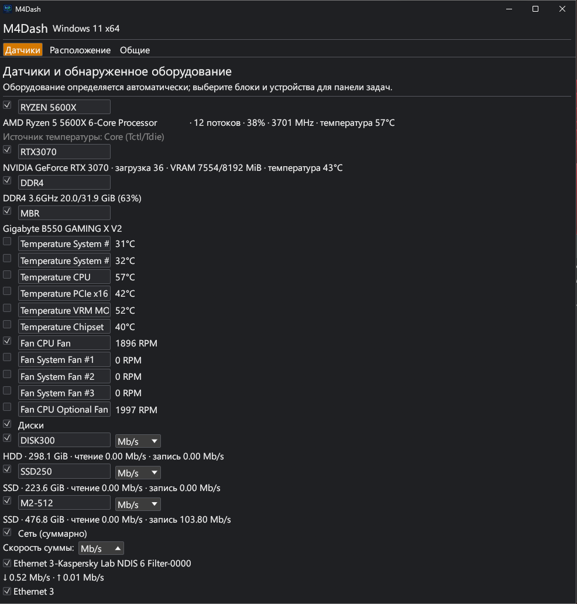
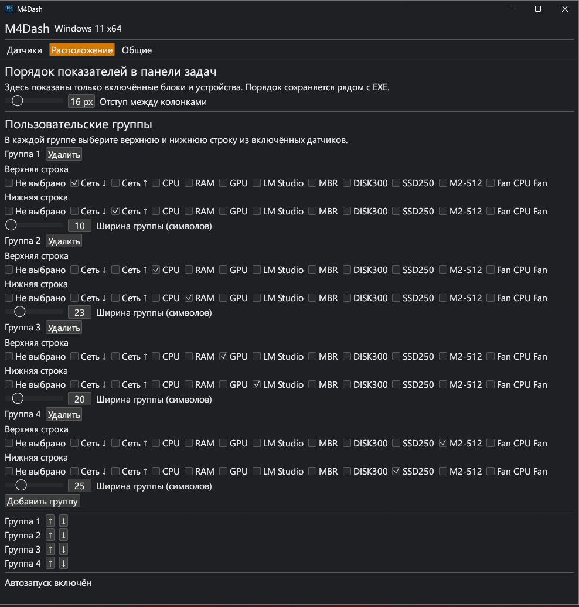
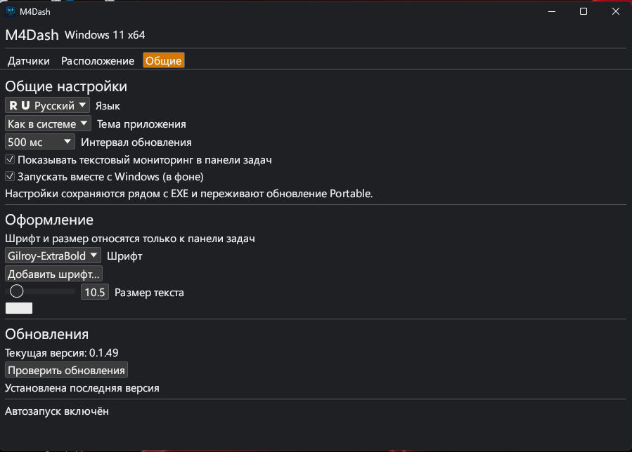

# M4Dash

**Live PC hardware and local LLM monitoring for Windows 11 x64.** M4Dash puts configurable sensor metrics in the taskbar and keeps them updating while the main window is hidden in the system tray.

[Download the latest Windows release](https://github.com/themaltsev/M4Dash/releases/latest) · [Report a problem](https://github.com/themaltsev/M4Dash/issues)

> M4Dash currently supports Windows only. macOS and Linux builds are not available yet.

## Install

Choose either package from the [latest release](https://github.com/themaltsev/M4Dash/releases/latest):

- **Windows Setup** (`M4Dash-Setup-<version>-x64.exe`) installs the app for the current user under `%LOCALAPPDATA%\Programs\M4Dash` and creates M4Dash shortcuts.
- **Portable** (`M4Dash-Portable-v<version>-x64.zip`) can be extracted to any writable folder. Run `M4Dash.exe` and keep `settings.json` beside it when replacing or moving the app files.

The app stores its settings next to the executable. When upgrading from M4 PC Monitor, Setup copies the settings and custom fonts into the new M4Dash folder. Portable users should choose a folder where their account can write files.

## What it monitors

- CPU, memory, disks, network interfaces, GPU, and available motherboard sensors.
- Optional local LLM status from LM Studio or a running RustingStrata server (model name and generation speed).
- User-defined two-row taskbar groups, sensor visibility, ordering, and spacing.

CPU and motherboard readings are provided by LibreHardwareMonitor. Other device metrics are collected by M4Dash. RAM bandwidth is omitted when no reliable live provider is available.

## Screenshots

Examples of the taskbar metrics and the Sensors, Layout, and General settings pages:

<p align="center">
  
</p>

<p align="center">
  
</p>

<p align="center">
  
</p>

<p align="center">
  
</p>

## Configure

Open **M4Dash** from the tray menu to edit settings:

- **Sensors** — enable sensors and configure the local LM Studio API address and `lms.exe` path.
- **Layout** — choose which values appear in each taskbar group, then arrange the groups and spacing.
- **General** — configure background startup with Windows, refresh interval, language, theme, and update controls.

The interface uses a larger Windows-style Segoe UI font. Font, text size, and color settings apply only to taskbar metrics. The theme can follow Windows (**System**) or be set to Light or Dark. English is the default; Russian, Brazilian Portuguese, Persian, Spanish, French, Italian, and Chinese are also available.

Launching M4Dash manually opens the settings window. Enable **Start with Windows (in the background)** to start hidden in the system tray at sign-in; taskbar metrics continue refreshing, and the tray icon can open the window or exit.

## Updates

M4Dash checks GitHub Releases at startup. You can also use **Check for updates** in General. When a newer Windows Setup is available, M4Dash asks before downloading or installing it. The installer is verified using its SHA-256 sidecar when available, updates into the current app folder, preserves `settings.json`, and restarts the app.

## Build from source

The release workflow builds the Windows MSVC app, M4Dash Setup installer, Portable ZIP, and SHA-256 checksums on GitHub Actions. For compatibility, releases also include an old-name Setup alias so earlier M4Dash versions can update. A local build requires Rust and NSIS 3:

```powershell
cargo build --release --target x86_64-pc-windows-gnu
./scripts/package-portable.ps1 -TargetTriple x86_64-pc-windows-gnu
./scripts/build-windows-setup.ps1 -TargetTriple x86_64-pc-windows-gnu
```

The setup script calls the Portable packager and requires `makensis` to be available on `PATH` (or in the standard NSIS installation directory).
